# Awesome Hardware Emulation & Calculator Simulation 🧮⚡

  

  
  
  
  
  

---

## 🌟 Overview & SEO Meta Summary

> **The ultimate curated directory of cycle-accurate Hardware Calculator Emulators, Computer Algebra Systems (CAS), Scientific Calculation Engines, and Digital Circuit Logic Simulators.**  
> Featuring top commercial SaaS platforms and premier open-source GitHub repositories for Texas Instruments (TI-84/TI-Nspire), HP (HP-42S/HP-48/HP Prime), Casio, Sharp, NumWorks, Symbolic Math, and HDL logic emulation.

Whether you are an embedded engineer verifying firmware, a student seeking free STEM calculators without subscription paywalls, a retrocomputing enthusiast preserving vintage calculator ROMs, or a hardware designer building Verilog/logic circuits, this awesome-list connects you to the best tools available.

---

## 📑 Table of Contents
- [📊 Sector Overview & Market Dynamics](#-sector-overview--market-dynamics)
- [☁️ SaaS & Commercial Platforms](#️-saas--commercial-platforms)
- [💻 Open-Source GitHub Projects](#-open-source-github-projects)
- [📈 Star History](#-star-history)
- [🛠️ How to Contribute](#️-how-to-contribute)
- [💖 Support & Thank You](#-support--thank-you)
- [⚠️ Disclaimer](#️-disclaimer)

---

## 📊 Sector Overview & Market Dynamics

The global Computational Mathematics, EdTech Calculator & Hardware Emulation Software market is valued at approximately **$5.4B–$7.1B+ in 2026**, expanding at a ~11%–15% CAGR propelled by browser-native STEM testing environments, open-source Python/Rust calculator firmware (NumWorks Epsilon, MicroPython), and WebAssembly hardware emulation. 

The consumer EdTech SaaS layer exhibits **strong consolidation** around Google (Photomath), Chegg (Mathway), Learneo (Symbolab), and Wolfram Research, while the **cycle-accurate calculator hardware emulation, symbolic computer algebra (CAS), and scientific calculator ecosystems are overwhelmingly powered by open-source software** (`CEmu`, `Epsilon`, `Free42`, `Qalculate!`, `SageMath`, `SymPy`, `Maxima`, `Logisim-evolution`).

---

## ☁️ SaaS & Commercial Platforms

*Sorted descending by company valuation / annual revenue scale.*

| Platform | Description | Company Scale (Valuation / Revenue) | Starting Paid Tier | Free Tier / Trial Limit |
| :--- | :--- | :--- | :--- | :--- |
| **[Photomath (Google)](https://photomath.com)** | 📱 Camera-based AI math solver and interactive step-by-step equation calculator integrated into Google's educational ecosystem. | **Part of Alphabet Inc.** (~$350B+ Alphabet revenue; ~$2T+ market cap) | **$9.99 / month** ($69.99 / year for Photomath Plus animated tutorials & textbook solutions) | **Forever Free Core App** (Unlimited camera scanning and basic step-by-step equation solving on iOS & Android) |
| **[Texas Instruments Cloud / TI-SmartView](https://ti.com)** | 🏫 Official TI-84 Plus CE, TI-Nspire CX II, and TI-30XS browser/desktop hardware emulators for classrooms and standardized exam prep. | **Part of Texas Instruments Inc.** (~$16B+ annual revenue; ~$180B+ market cap on NASDAQ) | **~$15 – $35 / user / year** (TI-SmartView CE / TI-Nspire CX Teacher/Student cloud subscription) | **90-Day Full-Access Free Trial** (Full TI-84 Plus CE / TI-Nspire CX II desktop emulator evaluation for 90 days; no perpetual free tier) |
| **[Casio ClassPad.net / fx-Cloud](https://classpad.net)** | 📐 Official Casio web-based CAS graphing calculator, geometry workspace, and ClassWiz fx-991CW / fx-CG50 hardware emulator suite. | **Part of Casio Computer Co., Ltd.** (~$1.8B+ annual revenue; public on TSE) | **~$10 – $25 / year** (ClassPad Math CAS add-on / ClassWiz Educator emulator subscription) | **Forever Free Basic Workspace** (100% free browser scientific/graphing sticky-notes calculator + 90-day ClassWiz hardware emulator trial) |
| **[Wolfram Alpha (Wolfram Research)](https://wolframalpha.com)** | 🔬 Computational knowledge engine and symbolic/numerical solver powered by Wolfram Language across mathematics, physics, and engineering. | **~$100M+ Annual Revenue** (Bootstrapped, profitable 35+ year computational science leader) | **$5.00 / month** billed annually ($9.99/mo monthly for Wolfram Alpha Pro; $7.99/mo Pro Premium) | **Forever Free Web & Mobile Query Tier** (Unlimited instant answers, plots, and unit conversions; step-by-step solutions require Pro) |
| **[Mathway (Chegg)](https://mathway.com)** | ⚡ Instant algebraic, calculus, trigonometry, linear algebra, and chemistry problem solver with graphing and step-by-step explanations. | **Part of Chegg, Inc.** (~$600M+ annual revenue; public on NYSE) | **$9.99 / month** ($39.99 / year for Mathway Plus step-by-step solutions) | **Forever Free Answer & Graphing Tier** (Unlimited problem input, graphing, and final answers free; step-by-step derivations require Plus) |
| **[Symbolab (Learneo / Course Hero)](https://symbolab.com)** | 🧠 Automated step-by-step calculus, differential equations, matrix, and symbolic algebra calculator with interactive practice sheets. | **Part of Learneo, Inc.** (~$500M+ group revenue; ~$3.6B peak valuation) | **$2.49 / week** billed annually ($9.95/mo monthly for Symbolab Pro) | **Forever Free Basic Solver** (Unlimited equation solving and basic steps; full detailed step-by-step breakdowns require Pro) |
| **[GeoGebra (BYJU'S / Independent)](https://geogebra.org)** | 📊 Dynamic mathematics software uniting 2D/3D graphing, CAS, geometry, spreadsheets, statistics, and scientific calculators across web and mobile. | **~$20M–$40M Est. Scale** (>100M students/teachers globally; open-core non-commercial software) | **$0 / Free for Non-Commercial & Education** (Commercial licensing available for proprietary EdTech embeds) | **100% Free Forever** (Unlimited Graphing Calculator, 3D Calculator, CAS, Geometry, and GeoGebra Classroom free for students & educators) |
| **[Desmos Studio](https://desmos.com)** | 📈 Premier browser-native 2D/3D graphing calculator, scientific calculator, matrix tool, and geometry engine embedded in major standardized exams. | **~$30M–$60M Est. Valuation** (Public Benefit Corporation spun out from Amplify) | **$0 / Free Consumer & Educator Calculators** (Enterprise assessment SDK licensing for testing organizations) | **100% Free Forever** (Unlimited browser/mobile Graphing, 3D, Scientific, Four-Function, and Matrix calculators with zero ads) |
| **[HP Prime Virtual Calculator (Moravia / HP)](https://hpcalc.org)** | 🖩 Official Windows, macOS, iOS, and Android hardware emulator of the HP Prime color touchscreen CAS graphing calculator. | **Licensed by Moravia Consulting / HP Inc.** (Official global HP calculator licensee) | **$19.99 – $24.99 one-time** (Mobile iOS/Android Pro app; desktop emulator bundled free) | **Forever Free Desktop Virtual Calculator** (Free Windows & macOS HP Prime hardware emulator + free Lite mobile app) |
| **[NumWorks Cloud Simulator](https://numworks.com)** | 🐍 Official browser-based WebAssembly hardware simulator of the open-hardware NumWorks Python graphing calculator. | **~$10M–$20M Est. Scale** (French modern graphing calculator innovator; open-source Epsilon OS) | **$0 / Free Browser Simulator** (Physical NumWorks graphing calculator hardware retails at **$99.95**) | **100% Free Forever** (Unlimited full-featured browser hardware simulator with built-in MicroPython IDE and exam mode) |

---

## 💻 Open-Source GitHub Projects

*Sorted descending by GitHub stargazers count.* Each repository features a live star badge linking directly to its stargazer community.

| Project & Repo | Stars Badge | License | Description |
| :--- | :---: | :---: | :--- |
| **[SymPy](https://github.com/sympy/sympy)** |  | `BSD-3-Clause` | 🐍 A comprehensive computer algebra system (CAS) written in pure Python for symbolic integration, calculus, and matrix mathematics. |
| **[Logisim-evolution](https://github.com/logisim-evolution/logisim-evolution)** |  | `GPL-3.0` | 🔌 Modern digital logic designer and processor architecture simulation tool with chronogram analysis and board synthesis support. |
| **[Digital](https://github.com/hneemann/Digital)** |  | `GPL-3.0` | 💡 An easy-to-use digital logic designer and circuit simulator implemented in Java, ideal for computer architecture education. |
| **[Verilator](https://github.com/verilator/verilator)** |  | `LGPL-3.0 / Artistic-2.0` | ⚡ Fastest open-source Verilog/SystemVerilog simulator that compiles hardware descriptions into high-speed C++/SystemC models. |
| **[SageMath](https://github.com/sagemath/sage)** |  | `GPL-3.0` | 🌐 Massive open-source mathematics software system combining NumPy, SciPy, matplotlib, SymPy, Maxima, GAP, and R. |
| **[NumWorks Epsilon](https://github.com/numworks/epsilon)** |  | `Creative Commons` | 📱 Complete open-source operating system and WebAssembly simulator for the modern NumWorks ARM-based graphing calculator. |
| **[CEmu](https://github.com/CE-Programming/CEmu)** |  | `GPL-3.0` | 🎮 Cycle-accurate third-party TI-84 Plus CE and TI-83 Premium CE graphing calculator hardware emulator with rich C/eZ80 debugger. |
| **[floooh/chips](https://github.com/floooh/chips)** |  | `Zlib` | 🕹️ Header-only 8-bit CPU and retro chip emulators (Z80, 6502, Intel 8080) in standalone C headers for building custom hardware emulators. |
| **[Qalculate! GTK](https://github.com/Qalculate/qalculate-gtk)** |  | `GPL-2.0` | 🧮 Multi-purpose desktop calculator engine featuring arbitrary precision, unit conversion, symbolic calculation, and plotting. |
| **[Wabbitemu](https://github.com/sputt/wabbitemu)** |  | `MIT` | 📟 Renowned Z80 hardware emulator for Texas Instruments TI-73, TI-81, TI-82, TI-83, TI-84 Plus, and TI-86 graphing calculators. |
| **[SpeedCrunch](https://github.com/speedcrunch/SpeedCrunch)** |  | `GPL-2.0` | 🚀 Fast, high-precision scientific desktop calculator with auto-completion, history scrollback, and 50 decimal digits of precision. |
| **[KnightOS z80e](https://github.com/KnightOS/z80e)** |  | `MIT` | 🔧 Modular Z80 processor and TI graphing calculator hardware emulator with interactive command-line and gdb-like debugger. |
| **[x48](https://github.com/gwenhael-le-moine/x48)** |  | `GPL-2.0` | 💾 Saturn processor hardware emulator for HP48 SX and HP48 GX scientific graphing calculators on Unix/X11 and POSIX systems. |

---

## 📈 Star History

---

## 🛠️ How to Contribute

Contributions are warmly welcomed! 🤝

1. 🍴 **Fork** this repository.
2. 🌿 Create a branch for your addition (`git checkout -b add-my-simulator`).
3. 📝 Add your entry under the appropriate table (ensure open-source additions include real star counts and links).
4. 🚀 Open a **Pull Request** explaining why the tool or emulator should be included.

---

## 💖 Support & Thank You

Thank you so much for exploring this collection! ⭐ If you find this directory helpful:

- ⭐ **Star this repository** to help others discover it on GitHub.
- 🍴 **Fork and share** with fellow developers, students, and engineers.
- ☕ If you'd like to support continued maintenance and development, please consider buying a coffee via our [GitHub Sponsor Dashboard](https://github.com/sponsors/ishandutta2007).

Your support keeps open-source documentation vibrant! 🙌

---

## ⚠️ Disclaimer

*All trademarks, logos, and brand names are the property of their respective owners (Texas Instruments, Casio, HP Inc., Alphabet/Google, Chegg, Learneo, Wolfram Research, NumWorks, etc.). Their inclusion in this repository is purely for identification, educational, and reference purposes and does not imply endorsement.*
